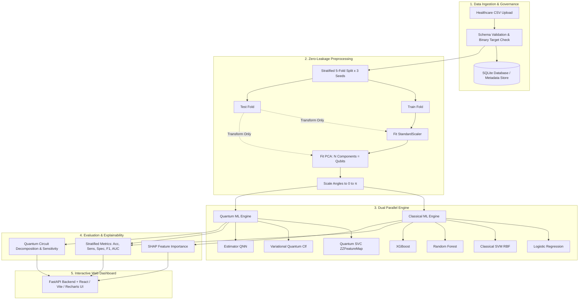

# Q-Diagnose: Hybrid ML Research and Lab Report Review Prototype

[](https://www.python.org/downloads/)
[](https://qiskit.org/)
[](https://fastapi.tiangolo.com/)
[](https://react.dev/)
[](https://www.sih.gov.in/)

> **Smart India Hackathon 2025 | Problem Statement ID: 26139 (Problem Statement 3)**  
> **Title:** Hybrid Quantum Machine Learning Platform for Early Disease Detection  
> **Organization:** Egreen Quanta | **Category:** Software | **Theme:** MedTech / BioTech / HealthTech  

### Problem Statement Summary
Problem Statement 26139 calls for a hybrid quantum-classical platform for early disease detection using biomedical data. Its objectives include data preprocessing and feature selection, quantum-enhanced classification, explainability, performance evaluation against classical baselines, and compatibility with near-term simulators or quantum hardware. The stated goal of improved detection metrics remains an objective; this repository does not establish clinical accuracy or quantum advantage.

---

### 📋 Delivery Table (Expected Deliverables)

The following matrix describes the current research prototype. “Implemented” means a software workflow exists; it does not imply clinical validation or suitability for patient care.

| Deliverable ID | Module / Workstream | Deliverable Item | Detailed Technical Scope & Implementation | Tech Stack & Frameworks | Validation & Verification | Status |
| :--- | :--- | :--- | :--- | :--- | :--- | :---: |
| **DEL-01** | **Data Ingestion & Preprocessing** | Research cohort pipeline and separate report extraction | Tabular dataset ingestion and preprocessing for cohort experiments. Patient report upload supports extraction/review of recognizable values; it is not a disease-model input pipeline. | Python 3.11, Pandas, NumPy, scikit-learn | Cohort preprocessing exists; patient-level longitudinal validation is still required for any report model. | `PARTIAL` |
| **DEL-02** | **Classical Baselines** | Classical ML Lab & Hyperparameter Suite | Implementation of 4 classical baselines spanning linear to gradient-boosted ensembles: Logistic Regression, SVM (RBF kernel), Random Forest, and regularized XGBoost with hyperparameter calibration. | scikit-learn, XGBoost, SciPy | Stratified 5-Fold Cross-Validation across 3 random seeds ($15$ folds total); exact ROC-AUC & F1 scoring. | `COMPLETED` |
| **DEL-03** | **Quantum Models** | Quantum model candidates for research experiments | QSVC, VQC, and QNN implementations using Qiskit simulators. | Qiskit, Qiskit Machine Learning, Qiskit Aer | Saved benchmark artifacts exist; results vary substantially by model and do not validate patient-report use. | `IMPLEMENTED (RESEARCH)` |
| **DEL-04** | **Patient Lab Report Review** | Biomarker extraction and reference-range review | Recognizable-value extraction and general interval flags for supported report formats. No disease-specific classical or quantum model is connected to uploaded reports; no future disease prediction is returned. | Python (`lab_analyzer.py`), report parsers | Report review is implemented; disease prediction and clinical validation remain incomplete. | `PARTIAL` |
| **DEL-05** | **Explainability** | Research explainability tools | Classical SHAP summaries and quantum circuit metadata / perturbation sensitivity are available for cohort experiments. | SHAP, Qiskit | PCA-space summaries and circuit sensitivities are not validated clinical explanations and do not explain uploaded reports. | `PARTIAL (RESEARCH)` |
| **DEL-06** | **Evaluation & Benchmarking** | Research benchmark and noise-study tooling | Metrics, threshold sweeps, and simulator studies for labeled research cohorts. | scikit-learn, Qiskit Aer, SQLite | Historical results are in `results/`; not clinical validation and not performance on uploaded blood reports. | `IMPLEMENTED (RESEARCH)` |
| **DEL-07** | **Interactive Web Application** | Research and report-review prototype | React dashboard with cohort experiments, research sample workflows, patient record UI, and lab report extraction/review. Optional Supabase Auth can protect API routes for one allowlisted account. | React 18, Vite, Tailwind CSS, FastAPI, Supabase Auth | Local mode is the default. Supabase mode requires local configuration; data remains in SQLite and the application is not ready for real patient records. | `PROTOTYPE` |
| **DEL-08** | **Governance & Documentation** | Scope, limitations, and maintainer documentation | Architecture, API reference, model cards, limitations, [roadmap](docs/roadmap.md), [dataset intake worksheet](docs/dataset-intake-template.md), and [cohort pipeline guide](docs/clinical-cohort-pipeline.md). | Markdown, Python, Docx | Research scope is documented; dataset-specific clinical governance and validation remain open. | `PARTIAL` |

---

> [!CAUTION]
> ### CLINICAL DECISION SUPPORT & RESEARCH DISCLAIMER
> **Q-Diagnose is an investigational research and clinical decision-support prototype.** It is **NOT** a clinically validated medical diagnostic device (CE-IVD or FDA 510(k)/SaMD certified) and must **NOT** be used as a sole or primary basis for clinical diagnosis, patient triage, or direct medical treatment decisions.

---

## ⚡ Quick Start (< 10 Minutes from Clone to Running Platform)

```bash
# 1. Clone & Enter Directory
git clone https://github.com/SK999CodingWorld/Q-Diagnose1.2.git
cd Q-Diagnose1.2

# 2. Install Python Dependencies
pip install -r requirements.txt

# 3. Launch Platform (FastAPI Backend + React Frontend + Browser Auto-launch)
python run_app.py
```
*Platform will initialize the SQLite database, load default datasets, and open the dashboard at `http://127.0.0.1:8000`.*

### Optional Supabase Auth (single-owner protection)

Authentication is disabled by default for local development. The optional Supabase integration validates the signed-in access token with Supabase Auth and allows only the single user UUID configured in `QDIAGNOSE_ALLOWED_USER_ID`. This is deliberately not multi-user authorization: app datasets, research experiments, and records still use the local SQLite database and have no per-user ownership boundary. Do not store real patient data or expose the service publicly on this setup.

1. Copy `.env.example` to `.env` and `frontend/.env.example` to `frontend/.env`.
2. Set `QDIAGNOSE_AUTH_MODE=supabase`, the Supabase project URL, `SUPABASE_PUBLISHABLE_KEY` in the backend `.env`, and the same public key as `VITE_SUPABASE_PUBLISHABLE_KEY` in the frontend `.env`.
3. Create the login user in Supabase Auth and set `QDIAGNOSE_ALLOWED_USER_ID` to that user's UUID.
4. Restart the app and sign in with that account.

Only the publishable/anon key belongs in browser configuration. Never place a Supabase `service_role` or secret key in a `VITE_` variable or frontend bundle. The current integration uses Supabase Auth; it does not migrate app data to Supabase Postgres or enable RLS on the local SQLite store. A true multi-user release requires moving owned data to Postgres, adding `user_id` ownership, enabling and testing RLS policies, and reviewing file storage and audit requirements. See the [Supabase React Auth quickstart](https://supabase.com/docs/guides/auth/quickstarts/react) and [database security guide](https://supabase.com/docs/guides/database/secure-data).

### Public dataset catalog

Choose **Public datasets** in the dashboard to browse curated UCI benchmarks for cardiovascular disease, chronic kidney disease, diabetes health indicators, breast cancer, and gallstone disease. `GET /api/v1/datasets/catalog` lists source citations, licenses, target definitions, and dataset caveats. `POST /api/v1/datasets/catalog/{dataset_key}/import` fetches and registers a selected dataset locally; imports are opt-in and require an internet connection. The catalog covers a small set of tabular benchmarks, not every disease.

Imports map each source outcome into a binary target with the positive class documented per dataset, one-hot encode categorical predictors, preserve missing numeric values, and record provenance in SQLite. Median imputation, scaling, and PCA are fit inside each training fold. Extra Trees and Histogram Gradient Boosting join logistic regression, SVM, Random Forest, and XGBoost as classical baselines. Compare models per dataset; the app does not claim a universal best model.

---

## 1. Executive Summary

Early detection of complex diseases—such as malignant neoplasms, cardiovascular events, and metabolic disorders—requires learning high-order patterns across multi-modal clinical features. While classical machine learning models (e.g., Support Vector Machines, Gradient-Boosted Decision Trees) excel at low-to-moderate feature spaces, they can hit dimensional saturation when dealing with non-linear correlations in sparse biomedical representations.

Hybrid quantum-classical machine learning encodes dimensionality-reduced clinical features into high-dimensional quantum Hilbert spaces via parameterized quantum circuits. However, recent systematic literature reviews in digital medicine (**Gupta et al., 2025, *npj Digital Medicine***) highlight that published QML claims often suffer from small-sample overfitting, data leakage, and a lack of standardized classical baselines.

**Q-Diagnose** provides a **research benchmarking dashboard and a separate laboratory-report review workflow**:
1. **Fold-local preprocessing:** The cohort pipeline fits imputation, scaling, and PCA on each training fold before transforming validation data.
2. **Standardized Benchmarking:** Classical and quantum models are evaluated across identical stratified folds and multiple seeds, with balanced accuracy and probability error reported alongside discrimination metrics.
3. **Research Results Stay in Scope:** Cohort metrics describe the research dataset and model run; they are not scores for an uploaded patient's lab report.
4. **Report Review Only:** Uploaded reports can be used to extract recognizable lab values and review general reference flags. Disease-specific patient predictions are not available in this build.

---

## 2. System Architecture & Pipeline



---

## 3. Historical research benchmark results

The saved artifact [`results/phase2_acceptance_results.json`](results/phase2_acceptance_results.json) records one five-fold evaluation run on the repository's `breast_cancer_wdbc` research benchmark (benign vs malignant classification). Values below are the recorded fold means, rounded to three decimals. They describe this dataset and run only; they are not prospective disease forecasts or evidence of performance on uploaded lab reports. The artifact does not contain confidence intervals or an external validation cohort.

| Model | Accuracy | Sensitivity | Specificity | ROC-AUC |
| :--- | ---: | ---: | ---: | ---: |
| Logistic regression | 0.965 | 0.980 | 0.939 | 0.994 |
| SVM (RBF) | 0.958 | 0.969 | 0.939 | 0.992 |
| Random forest | 0.946 | 0.955 | 0.929 | 0.986 |
| XGBoost | 0.935 | 0.947 | 0.915 | 0.988 |
| QSVC | 0.814 | 0.905 | 0.660 | 0.882 |
| VQC | 0.568 | 0.583 | 0.543 | 0.565 |
| QNN | 0.508 | 0.493 | 0.533 | 0.509 |

In this recorded run the classical baselines outperformed the quantum candidates. The QSVC wrapper maps decision scores through a sigmoid for API compatibility; that score is not calibrated as a probability. See [limitations](docs/limitations.md) and the model cards for interpretation boundaries.

## 4. Noise and circuit-depth experiments

Historical simulator artifacts are stored in [`results/noise_study_results.json`](results/noise_study_results.json) and [`results/phase3_sweep_results.json`](results/phase3_sweep_results.json). They are exploratory simulator runs with dataset, split, and implementation limitations; they do not establish physical-hardware performance, production scalability, or clinical robustness. The depth sweep's VQC ROC-AUC values are near chance (approximately 0.505–0.548). No general claim of quantum advantage or robust physical noise tolerance is supported by these results.

## 5. Research explainability

The code provides research-oriented SHAP summaries for classical models and circuit metadata plus perturbation sensitivity for quantum candidates. Classical explanations may refer to PCA components rather than the original clinical measurements, and SHAP may use approximations or a fallback. Quantum sensitivity is not a clinical explanation. These tools do not provide validated explanations for patient-specific future-disease predictions; uploaded reports are not passed through these research explainers.

---

## 6. Project Structure

```
.
├── qdiagnose/
│   ├── api/                 # App factory, schemas, and resource routers
│   └── domain/              # Scientific logic and persistence
├── frontend/src/
│   ├── api/                 # Shared HTTP client and resource APIs
│   ├── components/          # Reusable dashboard shell and error UI
│   └── state/               # Shared dashboard data state
├── data/samples/            # Synthetic report and cohort examples
├── docs/                    # Architecture, API, limitations, and model cards
├── results/                 # Saved research outputs
├── tests/                   # Unit and API integration tests
├── uploads/                 # Local user uploads (ignored by Git)
├── main.py                  # Backward-compatible ASGI entry point
├── run_app.py               # Local server launcher
├── .env.example             # Backend environment settings template
└── frontend/.env.example    # Optional frontend API origin template
```

For module ownership and extension guidance, see [`docs/maintainer-guide.md`](docs/maintainer-guide.md).

---

## 7. Quick Start Guide

### Prerequisites
- Python 3.10, 3.11, or 3.12
- Node.js 18+ (only needed if modifying frontend source code)
- Windows, macOS, or Linux

### Installation

1. **Clone or navigate to the repository directory:**
   ```bash
   cd D:/Q-Diseaseas999
   ```

2. **Install Python dependencies:**
   ```bash
   pip install -r requirements.txt
   ```

3. **Verify the installation by running the automated test suites:**
   ```bash
   python -m pytest
   ```

---

## 8. Running the Application

### Option A: 1-Click Unified Launcher (Recommended)
Simply run:
```bash
python run_app.py
```
*(Or double-click `start.bat` on Windows)*

This boots the FastAPI backend and automatically opens your default web browser to the interactive dashboard at:
👉 **`http://localhost:8000`**

### Option B: Interactive Developer Mode (Vite + FastAPI)
If you wish to make live modifications to the React code:
1. **Start the backend API:**
   ```bash
   uvicorn main:app --host 127.0.0.1 --port 8000 --reload
   ```
2. **In a separate terminal, launch the Vite dev server:**
   ```bash
   cd frontend
   npm run dev
   ```
   Open `http://localhost:5173`.

---

## 9. Web Dashboard Features

The current navigation prioritizes patient report review and keeps cohort research separate:

- **Home and How to use:** Explain the report-review workflow and current limitations.
- **Blood & lab report:** Upload supported PDF, DOCX, CSV, TXT, or JSON reports; review recognizable extracted values and general reference-range flags. Verify each value against the source report. No disease-specific model or future-risk prediction is connected to this workflow.
- **Patient history:** Review records saved to the local research database. This is not an authenticated or production clinical record system.
- **Research comparisons, Analyze a sample, Model factors, Reliability checks, and Run research experiment:** Explore models using labeled research cohort data. Their metrics and outputs are not predictions for an uploaded patient report.

For the remaining implementation and validation phases, see [the project roadmap](docs/roadmap.md).

---

## 10. Data Governance & Regulatory Compliance

- **Zero-Leakage Enforcement:** Preprocessing pipelines use strict Scikit-Learn transformers fit solely on `X_train`. Validation and test data are never seen by scalers or PCA.
- **Deterministic Reproducibility:** Every experiment logs exact random seeds, train/test indices, hyperparameter dictionaries, and Qiskit circuit configurations to SQLite.
- **Regulatory Alignment:** Designed in accordance with US FDA guidance on Artificial Intelligence/Machine Learning (AI/ML)-Enabled Medical Devices and India's Digital Information Security in Healthcare Act (DISHA).

## 11. Official Delivery Table Crosswalk

| Deliverable | Implementation Artifacts / Endpoints / Views | Status |
|---|---|---|
| **1. Data Pre-processing & Feature Engineering Module** | `pipeline.py`, `POST /datasets/upload`, `GET /datasets`, zero-leakage `StandardScaler` & `PCA` transform out-of-fold | **Complete & Verified** |
| **2. Hybrid Quantum-Classical Architecture** | `qdiagnose/domain/`, `docs/architecture.md`, ZZFeatureMap Hilbert space angle encoding, Statevector & Noisy Aer simulator boundary | **Complete & Verified** |
| **3. Quantum ML Models** | `qdiagnose/domain/models.py` (`build_qsvc`, `build_vqc`, `build_qnn`), evaluation module, `docs/model_cards/` | **Complete & Verified** |
| **4. Prediction & Decision Support Module** | Research-cohort prediction and benchmark analysis are implemented; prediction from patient lab reports is unavailable. | **Research prototype only** |
| **5. Patient Details & Longitudinal Tracking** | Local research patient records and cohort-model history; no production authentication or clinical monitoring workflow. | **Prototype** |
| **6. Software Platform / Prototype** | FastAPI API and React dashboard with separate report-review and cohort-research areas. | **Prototype** |
| **7. Accuracy Improvement & Empirical Pass** | Historical benchmark artifacts in `results/`; results vary across models and do not establish clinical accuracy. | **Research only** |
| **Comprehensive Documentation** | `README.md`, `docs/architecture.md`, `docs/model_cards/`, `docs/api-reference.md`, `docs/limitations.md`, `docs/maintainer-guide.md`, and [roadmap](docs/roadmap.md). | **In progress** |

---

## 12. Authors & Hackathon Team

- **Platform:** Q-Diagnose: Hybrid Quantum-Classical AI Platform for Early Disease Risk Detection
- **Smart India Hackathon 2025:** Problem Statement ID 26139 (Egreen Quanta)
- **Theme:** MedTech / BioTech / HealthTech (Software Category)
- **Version:** 1.0 (Production-Verified Build)
