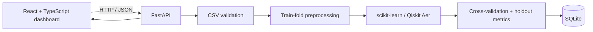

# Q-Diagnose

**Hybrid classical and quantum machine-learning research dashboard**

Q-Diagnose is a local web application for repeatable experiments on **binary, structured tabular datasets**. It combines a React/TypeScript dashboard, a FastAPI service, scikit-learn models, Qiskit simulators, and SQLite experiment storage.

> [!CAUTION]
> **Research prototype only.** Q-Diagnose is not a medical device and has not been clinically validated. It does not diagnose patients, estimate an individual's future disease risk from a laboratory report, or provide medical advice. Do not use its output to guide screening, treatment, or patient-care decisions.

## Contents

- [Project scope](#project-scope)
- [Capabilities](#capabilities)
- [Architecture](#architecture)
- [Requirements](#requirements)
- [Install and run](#install-and-run)
- [Use the dashboard](#use-the-dashboard)
- [Data formats and restrictions](#data-formats-and-restrictions)
- [Experiment design and interpretation](#experiment-design-and-interpretation)
- [Models and backends](#models-and-backends)
- [HTTP API](#http-api)
- [Configuration and local storage](#configuration-and-local-storage)
- [Privacy and security](#privacy-and-security)
- [Development and checks](#development-and-checks)
- [Repository layout](#repository-layout)
- [Known limitations](#known-limitations)

## Project scope

This repository implements a **research benchmarking workflow**, not a patient-facing diagnostic workflow. It accepts labeled cohort data, trains binary classifiers, records evaluation artifacts, and lets users compare experiments.

It does not ingest blood-report PDFs or medical images, connect lab values to a validated disease model, or return a patient-level prediction. The available datasets and metrics are research examples, not evidence that a model can diagnose or forecast disease.

## Capabilities

- Register the built-in scikit-learn breast-cancer dataset and a diabetes-progression demonstration dataset.
- Upload and validate a labeled CSV cohort.
- Compare logistic regression, RBF support-vector machine, random forest, XGBoost, QSVC, VQC, and QNN.
- Run stratified cross-validation with multiple seeds and a separate stratified holdout evaluation.
- Review accuracy, precision, sensitivity, specificity, F1, ROC-AUC, PR-AUC, confusion matrices, ROC and precision-recall curves, and probability calibration.
- Run supported parameter sweeps and cross-dataset comparisons.
- View experiment configuration, runtime, preprocessing provenance, selected feature attributions, quantum-circuit sensitivity, and circuit previews.
- Persist datasets, experiment records, folds, metrics, and explanations in SQLite.

## Architecture



The production API serves the built frontend from `frontend/dist`. During frontend development, Vite runs separately on port 5173 and proxies `/api` requests to FastAPI on port 8000.

## Requirements

- Python 3.11 or newer
- Node.js 20 LTS or 22 LTS, with npm
- Git, to clone the repository

Python package versions are pinned in `requirements.txt`; JavaScript package versions are locked in `frontend/package-lock.json`.

## Install and run

Run commands from the repository root unless stated otherwise.

### 1. Create a Python environment and install the API dependencies

Windows PowerShell:

```powershell
py -3.11 -m venv .venv
.\.venv\Scripts\Activate.ps1
python -m pip install --upgrade pip
python -m pip install -r requirements.txt
```

macOS or Linux:

```bash
python3.11 -m venv .venv
source .venv/bin/activate
python -m pip install --upgrade pip
python -m pip install -r requirements.txt
```

If PowerShell blocks environment activation, use the Python executable inside `.venv` directly or adjust the local PowerShell execution policy according to your organization's rules.

### 2. Install frontend dependencies and build the dashboard

```bash
cd frontend
npm ci
npm run build
cd ..
```

### 3. Start the local API and website

```bash
python -m uvicorn main:app --host 127.0.0.1 --port 8000
```

Then open:

- Dashboard: [http://127.0.0.1:8000/](http://127.0.0.1:8000/)
- Interactive API documentation: [http://127.0.0.1:8000/docs](http://127.0.0.1:8000/docs)
- API health/status: [http://127.0.0.1:8000/api/health](http://127.0.0.1:8000/api/health)

The frontend build is required for the dashboard route. Re-run `npm run build` after frontend changes.

### Frontend development server

Keep the FastAPI server running in one terminal. In another terminal:

```bash
cd frontend
npm ci
npm run dev
```

Open [http://127.0.0.1:5173](http://127.0.0.1:5173). Vite proxies API requests to `http://127.0.0.1:8000`.

## Use the dashboard

1. **Register data.** Add the built-in breast-cancer or diabetes-progression dataset, or upload a cohort CSV.
2. **Configure an experiment.** Select a dataset, model, backend, PCA feature count, fold count, seeds, and any applicable quantum-model settings.
3. **Run and review.** Review cross-validation summaries, holdout calibration, curves, confusion matrix, runtime, and saved configuration.
4. **Explore comparisons.** Use parameter sweeps or cross-dataset validation to compare supported configurations.

The experiment form may take noticeably longer for quantum models, larger fold/seed counts, or parameter sweeps. Start with the defaults and small datasets while learning the workflow.

### Example: register the built-in benchmark

```bash
curl -X POST http://127.0.0.1:8000/api/datasets/builtin
```

The response includes the registered dataset ID. Use that ID in an experiment request.

### Example: create an experiment

This request uses the default 5-fold, 3-seed settings. Replace `dataset_id` with the ID returned by the dataset endpoint.

```bash
curl -X POST http://127.0.0.1:8000/api/experiments \
  -H "Content-Type: application/json" \
  -d '{
    "dataset_id": 1,
    "model_type": "logistic_regression",
    "backend": "ideal_simulator",
    "n_features": 4,
    "cv_folds": 5,
    "seeds": [42, 123, 2025],
    "test_size": 0.2
  }'
```

On Windows, use `curl.exe` in PowerShell or submit the request through `/docs`.

### Example: upload a CSV

```bash
curl -X POST http://127.0.0.1:8000/api/datasets/upload \
  -F "file=@cohort.csv" \
  -F "target_column=diagnosis"
```

The file must satisfy the validation rules below. The API returns dataset metadata, class mapping, a summary, and a small feature preview.

## Data formats and restrictions

### Supported input

- **CSV only** for user uploads.
- One row per independent sample and columns for predictors plus one binary target.
- Numeric and categorical predictors are supported. Numeric missing values are median-imputed; categorical missing values are most-frequent-imputed and categorical predictors are one-hot encoded.
- The upload limit is **10 MiB per file**.
- No row-count or column-count cap is defined by the upload endpoint. Practical limits depend on available memory, preprocessing cost, and model runtime.

### Target validation and label meaning

- If specified, the requested target column must exist.
- Otherwise, the API selects the first matching name, in this order: `target`, `label`, `diagnosis`, `class`, `outcome` (case-insensitive, with surrounding whitespace ignored). If none matches, the **last CSV column** is used.
- The target may not contain missing values and must have **exactly two distinct classes**. Multiclass and continuous regression targets are rejected.
- Numeric `0/1` labels are retained. Other binary labels are mapped to 0 and 1 and the mapping is stored with the dataset. For non-boolean labels outside `0/1`, the mapping is ordered by the string form of each value.
- Precision, sensitivity, specificity, and F1 treat encoded class **1** as the positive class. Always inspect the saved target mapping before interpreting these metrics.

**Built-in breast-cancer label semantics:** the scikit-learn loader encodes malignant as 0 and benign as 1. Therefore, the application's positive-class sensitivity for this dataset is sensitivity for the **benign** class. Do not read it as cancer-detection sensitivity.

**Built-in diabetes label semantics:** this is the scikit-learn diabetes-progression regression dataset converted to a binary task: label 1 means the regression target is at or above its dataset median. It is not a diabetes diagnosis dataset and does not label diabetes status.

### Not supported

This build does not accept or analyze:

- PDF, DOCX, image, DICOM, genomic, free-text, or EHR uploads.
- Multiclass labels, unsupervised data, time-series sequences, or regression targets as uploaded prediction tasks.
- Individual patient lab reports or patient-level disease-risk predictions.

Do not upload identifiable patient records or data unless you have appropriate authority, consent, and an approved environment. See [Privacy and security](#privacy-and-security).

## Experiment design and interpretation

Each experiment:

1. Makes a stratified train/holdout split using `test_size` (default 0.20) and `split_seed` (default 42).
2. Runs stratified cross-validation on the training partition.
3. Fits imputation, encoding, scaling, PCA, and any quantum range scaling **inside each training fold**, then transforms that fold's validation partition.
4. Fits a final model on the training partition and evaluates it on the held-out partition.

The displayed cross-validation metric summaries aggregate folds across the selected seeds (default: 5 folds × 3 seeds = 15 validation runs). The saved holdout artifacts and probability-calibration summary are separate from those cross-validation averages.

- Binary predictions use a fixed probability threshold of **0.5** in this implementation.
- Cross-validation summaries include each metric's mean and standard deviation.
- The representative confusion matrix and plotted curves come from one recorded fold; they are not averaged curves.
- Probability calibration uses holdout predictions and 10 bins. Calibration is an evaluation view, not a guarantee that probabilities are accurate or clinically meaningful.
- Results depend on cohort composition, class balance, target mapping, data quality, split, preprocessing, model, and settings.
- At least `cv_folds` training rows from **each class** are required after the holdout split.
- Existing records store a pipeline revision. A result from another revision may be marked superseded and should not be assumed directly comparable.

### Experiment parameters

The API defaults are: 4 PCA features, ideal simulator, circuit depth 2, 5 folds, seeds `[42, 123, 2025]`, COBYLA optimizer, 25 optimizer iterations, 512 shots, noise multiplier 0.01, split seed 42, and 20% holdout.

The API validates parameter bounds including:

| Parameter | Accepted range / values |
| --- | --- |
| PCA features | 1–32 generally; quantum models allow at most 8. Feasible PCA dimensions also depend on the training data. |
| Backend | `ideal_simulator`, `noisy_simulator`, `real_hardware` (unavailable; see below) |
| Circuit depth | 1–12 |
| Cross-validation folds | 3–20 |
| Random seeds | 3–10 integer seeds |
| Optimizer iterations | 10–500 in the HTTP request schema |
| Shots | 1–100,000 |
| Noise multiplier | 0–0.25 |
| Holdout fraction | Greater than 0 and less than 1 |

Quantum simulation and high fold/seed counts can be computationally expensive. Parameter sweeps accept 1–20 values, but each value runs a separate experiment; the requested variable must affect the selected model/backend combination.

## Models and backends

| Model | Family | Notes |
| --- | --- | --- |
| `logistic_regression` | Classical | scikit-learn logistic regression |
| `svm` | Classical | RBF-kernel support-vector classifier |
| `random_forest` | Classical | scikit-learn random forest |
| `xgboost` | Classical | XGBoost binary classifier |
| `qsvc` | Quantum | Quantum support-vector classifier with a quantum feature-map kernel |
| `vqc` | Quantum | Variational quantum classifier |
| `qnn` | Quantum | Quantum neural-network classifier; execution may refuse results if its output is not deterministic in the installed environment |

### Backends

- `ideal_simulator`: Qiskit Aer ideal simulation.
- `noisy_simulator`: Qiskit Aer simulation with a depolarizing noise model; noise applies to quantum circuits, not classical models.
- `real_hardware`: **not implemented**. IBM credentials or an optional runtime package do not make hardware execution available. The application intentionally refuses hardware requests and does not silently fall back to simulation.

Quantum models are limited to 8 PCA features in this implementation. QSVC uses a fixed feature map rather than a trainable ansatz; variational model settings apply only where supported.

## HTTP API

Interactive, schema-backed documentation is available at `/docs`. The main endpoints are:

| Method | Endpoint | Purpose |
| --- | --- | --- |
| `GET` | `/api/health` | API, registered dataset/experiment counts, and hardware status |
| `GET` | `/api/models` | Supported model types and metrics |
| `GET` | `/api/backends` | Backend descriptions and availability |
| `GET` | `/api/datasets` | List registered datasets |
| `POST` | `/api/datasets/builtin` | Register or reuse the breast-cancer benchmark |
| `POST` | `/api/datasets/builtin/diabetes` | Register or reuse the median-split diabetes demonstration dataset |
| `POST` | `/api/datasets/upload` | Validate and register a CSV |
| `GET` | `/api/datasets/{dataset_id}` | Dataset metadata and associated experiments |
| `POST` | `/api/experiments` | Run and persist an experiment |
| `GET` | `/api/experiments` | List saved experiments |
| `GET` | `/api/experiments/{experiment_id}` | Retrieve a saved experiment |
| `GET` | `/api/experiments/{experiment_id}/progress` | Read execution status/progress |
| `GET` | `/api/experiments/{experiment_id}/folds` | Retrieve fold-level results |
| `GET` | `/api/experiments/{experiment_id}/explanation` | Generate or retrieve research explanations |
| `GET` | `/api/experiments/{experiment_id}/calibration` | Retrieve calibration artifacts |
| `POST` | `/api/experiments/{experiment_id}/calibrate` | Recalculate holdout calibration |
| `GET` | `/api/experiments/{experiment_id}/circuit` | Retrieve quantum-circuit details where applicable |
| `POST` | `/api/sweeps` | Run an applicable parameter sweep |
| `POST` | `/api/phase5/validate` | Run a cross-dataset comparison |
| `GET` | `/api/comparisons` | Read saved comparison rows |

Invalid input may return 4xx responses; unsupported/unavailable hardware returns 503. Consult `/docs` for exact request schemas, defaults, and response structures.

## Configuration and local storage

### Environment

`.env.example` documents optional environment variable names:

- `QDIAGNOSE_UPLOAD_DIR`: directory for uploaded CSV files; default is `data/uploads`.
- `QISKIT_IBM_TOKEN` and `IBM_QUANTUM_TOKEN`: checked for future hardware configuration, but **do not enable hardware execution in this version**.

The application reads environment variables from the process environment; it does not load a `.env` file automatically. Set variables in the shell or your process manager before starting the API.

Windows PowerShell example for a custom upload directory:

```powershell
$env:QDIAGNOSE_UPLOAD_DIR = "D:\q-diagnose-data\uploads"
python -m uvicorn main:app --host 127.0.0.1 --port 8000
```

### Stored data

- SQLite database: `q_diagnose.db` in the process working directory.
- Uploaded source CSVs: `data/uploads/` by default, or the configured upload directory.
- The database stores dataset metadata, mappings, summaries, file paths, experiment configuration, fold metrics, holdout artifacts, and explanations.
- Uploaded CSVs are retained until manually removed. There is no dataset deletion, account management, or retention API in this build.
- Runtime databases, upload data, frontend build output, and logs are ignored by Git. Do not commit patient data, credentials, or generated experiment artifacts.

To clear local application data, stop the API, remove the local database, and remove uploaded CSVs from the active upload directory. Keep any backups required by your data-governance policy.

## Privacy and security

This is a local research prototype, not a secured multi-user service:

- There is no authentication, authorization, user isolation, or audit identity.
- The API enables cross-origin requests broadly.
- The SQLite database and uploaded CSV files are not encrypted by this application.
- Upload files and experiment records have no automatic retention or deletion workflow.
- The documented server command binds to loopback (`127.0.0.1`). Do not change it to a public interface or expose it through a reverse proxy without adding appropriate access controls, network restrictions, secure storage, and operational review.
- Use de-identified or otherwise approved research data only. Follow applicable consent, institutional review, and data-protection requirements.

## Development and checks

Run the Python test suite from the repository root:

```bash
python -m pytest
```

Build and type-check the frontend:

```bash
cd frontend
npm ci
npm run build
```

The frontend build script runs TypeScript project checks before Vite creates the production bundle.

## Repository layout

```text
.
├── main.py                 # FastAPI app, API routes, static dashboard serving
├── datasets.py             # CSV validation, built-in data, dataset registration
├── pipeline.py             # Imputation, encoding, scaling, PCA
├── model_registry.py       # Classical/quantum model and backend construction
├── experiment_runner.py    # Experiment settings, CV, holdout, artifacts
├── evaluate.py             # Metrics and evaluation utilities
├── explanations.py         # SHAP and quantum sensitivity explanations
├── phase5.py               # Cross-dataset validation workflow
├── storage.py              # SQLite persistence
├── frontend/
│   ├── src/App.tsx          # Dashboard UI and experiment workflows
│   ├── src/styles.css       # Dashboard styling
│   └── public/              # Static assets, including the Q-Diagnose logo
├── test_phase1.py           # Core evaluation tests
├── test_phase2.py           # Experiment and API tests
└── test_audit.py            # Data, storage, and behavior audit tests
```

## Known limitations

- The project currently covers labeled binary tabular experiments only; it is not an all-diseases dataset or a general clinical prediction system.
- Benchmark performance is not externally validated and should not be generalized to other hospitals, populations, or patients.
- Quantum models run on simulators; this code does not demonstrate a quantum advantage or support live quantum-hardware execution.
- Explanation and feature-attribution outputs are model-research aids, not causal findings or clinically validated explanations.
- Dataset quality, target-label meaning, sample size, missingness, class imbalance, and distribution shift affect results.
- Production deployment requires substantial additional work, including clinical validation, privacy/security controls, monitoring, governance, and domain review.
